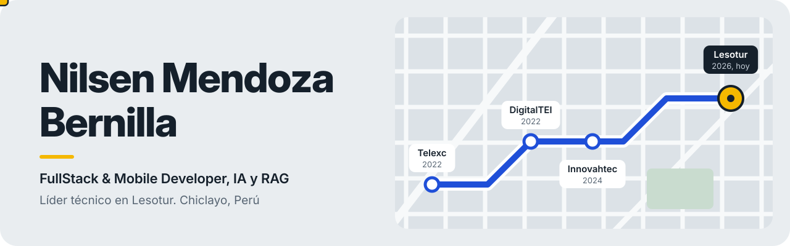
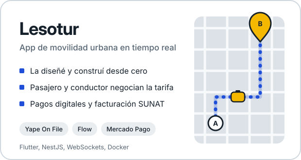
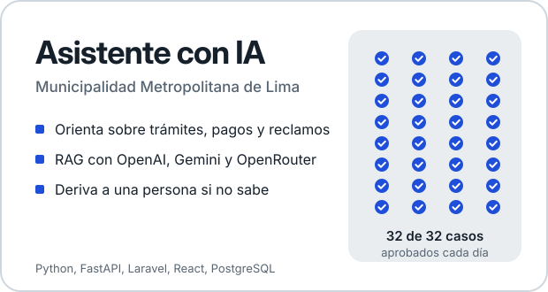
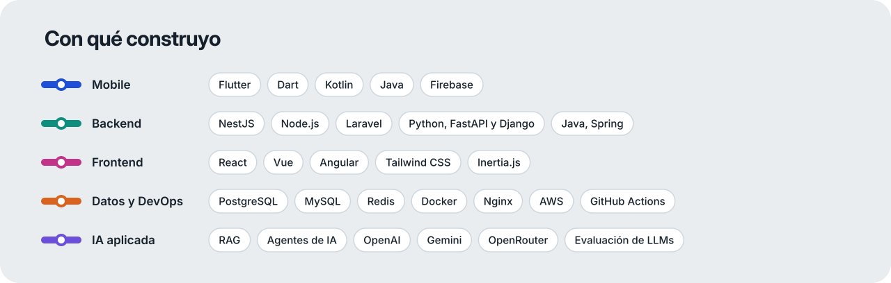

  

  
  
  
  

## Sobre mí

Bachiller en **Ingeniería de Sistemas** con más de 4 años desarrollando aplicaciones móviles, web y backend de punta a punta.

- 🚕 Lidero el desarrollo técnico de **[Lesotur](https://lesotur.com)**, una app de movilidad urbana en tiempo real con pagos digitales (Yape On File, Flow, Mercado Pago) y facturación electrónica SUNAT.
- 🤖 Desarrollé el **asistente virtual con IA de la Municipalidad Metropolitana de Lima**: RAG, varios proveedores de modelos y evaluación automática de la calidad de las respuestas.
- 🏗️ Trabajo con Clean Architecture, microservicios, WebSockets, Docker y CI/CD.
- ⚡ Uso a diario Claude Code y GitHub Copilot para entregar más rápido y con mejor calidad.

## Proyectos destacados

  
  

  <a href="https://lesotur.com">🌐 Web de Lesotur</a> &nbsp;&nbsp;|&nbsp;&nbsp;
  <a href="https://play.google.com/store/apps/details?id=com.lesotur.app">📱 Lesotur en Google Play</a>

> 🔒 La mayoría de mis proyectos profesionales son privados por acuerdos con clientes. Con gusto los muestro en una entrevista.

## Stack

  

## En GitHub

  
  

  

